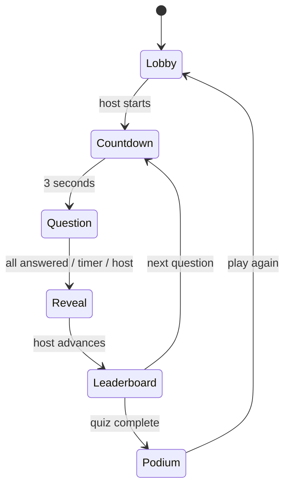

# Quizroom

A free, open-source multiplayer quiz game you can run yourself. The initial release has no subscriptions, paid tiers, or paywalls.

This is an independent reconstruction of the classic live-quiz loop, built after inspecting the public `kahoot.it` player application with REA. It has its own interface, questions, server, and protocol. It does not connect to Kahoot games and is not affiliated with Kahoot.

**Status:** playable prototype with a hosted-preview template; broader public hosting still needs the reliability and abuse-protection work listed below. Quizroom is a working name, pending a public launch name.

[Source on GitHub](https://github.com/cloudcorehub/quizroom) · [Deploy a preview on Render](https://render.com/deploy?repo=https%3A%2F%2Fgithub.com%2Fcloudcorehub%2Fquizroom) · [Hosting guide](DEPLOYMENT.md)

## Run

Requires Node.js 22 or later. There are no npm dependencies or build steps.

```sh
git clone https://github.com/cloudcorehub/quizroom.git
cd quizroom
npm start
```

Open <http://localhost:4173>.

1. Choose **Host this quiz**, or **Create a quiz** to write your own questions.
2. In the lobby, choose **Open player screen**. It opens another tab with the PIN filled in.
3. Enter a nickname, then return to the host tab and start the game.
4. Answer from the player tab. The host advances through answers, the leaderboard, and the podium.

For phones or other computers on your Wi-Fi, stop the local server and run:

```sh
HOST=0.0.0.0 npm start
```

Use the `On your Wi-Fi` address printed in the terminal on both host and player devices. `localhost` always refers to the device opening the URL. The default start command binds only to this computer.

## Play over the internet

Use the included [Render deployment template](render.yaml) to run a free preview on a supplied HTTPS address. You do not need a custom domain or a native mobile app. See [DEPLOYMENT.md](DEPLOYMENT.md) for the setup steps, costs, and current limitations.

Keep one server instance. Free hosting can sleep, and this version loses active games whenever the server restarts. The template disables automatic deploys to reduce accidental interruptions; it does not add persistence or make the prototype production-ready.

## Included

- Three original starter quizzes, each with five questions.
- Quiz editor: up to 50 questions, four answers, a correct-answer selector, and 5–120 second timers.
- Draft autosave in this browser and JSON export.
- Six-digit room PINs, nicknames, room locking, and late joins before the podium.
- Host and player screens with live updates; up to 100 players per room is an enforced limit, not a tested capacity claim.
- Countdown, synchronized questions, one answer per question, automatic timer expiration, and early reveal.
- Speed-based points, answer distribution, ranking, streak display, and final podium.
- Refresh/reconnect restoration within the same browser tab.
- Replay and final-score CSV export.
- Responsive layouts, keyboard answers (1–4), labeled controls, and reduced-motion support.

## Implementation

`server.mjs` is a Node HTTP server. Player and host commands use JSON POST requests. Server-sent events broadcast a separate, filtered state snapshot to each participant. The server owns question deadlines and scoring. Player requests cannot advance the game, answers cannot be changed after submission, and the correct choice is withheld until the reveal.



The frontend lives in `public/app.js` and `public/style.css`. The server serves an explicit asset list; source code and research files are not public routes.

## Verification

```sh
npm test
```

Three test cases passed on 2026-10-26. They exercise real HTTP connections and an SSE stream: two-player play, server timers, answer privacy, host authorization, duplicate/stale/late answer rejection, room locking, score recovery, podium/replay, malformed inputs, static asset boundaries, and the published scoring examples.

The repository also includes GitHub Actions checks for Node.js 22 and 24. Hosting probes use the tested `/healthz` endpoint.

A browser run also completed the custom-editor → host lobby → separate player → countdown → answer → reveal → leaderboard → podium flow. Refreshing the player preserved the recorded score of 837. Desktop and narrow layouts were visually inspected.

## Scope

This is a local classic-quiz prototype. Active rooms and scores are held in memory and reset when the server stops; stale rooms expire after six hours without game activity. Draft questions persist only in browser local storage. Host/player tokens survive a page refresh in that tab, not a new browser or device.

It does not implement Kahoot accounts, billing, discovery content, assignments, media uploads, team modes, AI generation, institutional reporting, or alternate game modes. Public deployment would need persistence, transport security, rate limiting, operational monitoring, and load testing.

The release plan is a free web beta. There is no payment integration or subscription work planned for the initial release. Operators cover their own domain and infrastructure costs. A separate native mobile app is not required to play through a phone browser.

## Contributing and license

See [CONTRIBUTING.md](CONTRIBUTING.md) for development instructions and current priorities.

Original project code and documentation are available under the [MIT license](LICENSE). You can use, modify, self-host, and redistribute them; MIT also permits commercial reuse by others. The license does not grant rights to third-party research artifacts or third-party names and branding.

`private: true` in `package.json` prevents accidental publication to the npm registry; it does not restrict the MIT license or public source sharing.

## Source distribution

The package manifest explicitly includes only the application, tests, license, and project documentation. To create a source archive:

```sh
mkdir -p dist
npm pack --ignore-scripts --pack-destination dist
```

Extract the archive, open its `package` directory, and run `npm start`. No dependency installation is needed. The archive does not include research captures or downloaded third-party scripts.

## Research

See [REVERSE_ENGINEERING.md](REVERSE_ENGINEERING.md) for observed behavior, client-code findings, evidence provenance, the reconstruction mapping, and coverage limits.

Local research artifacts live under `research/`. The entire directory is excluded from Git and source archives, including captured third-party scripts, evidence bundles, and screenshots. None is imported by the reconstruction. The research report describes these local files; they are intentionally absent from the public source distribution.
